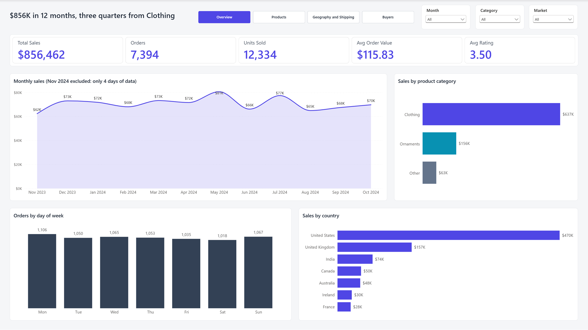
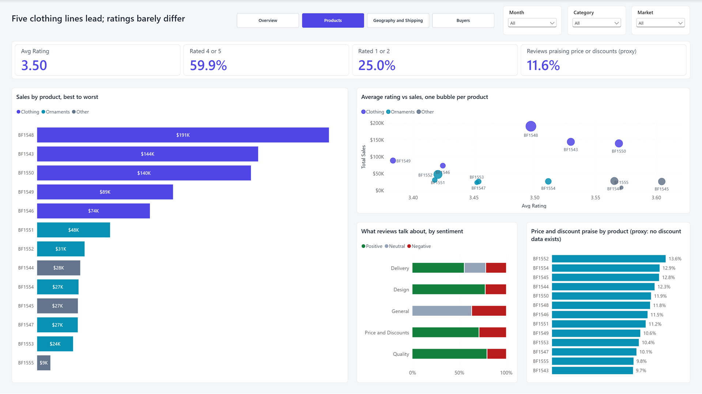
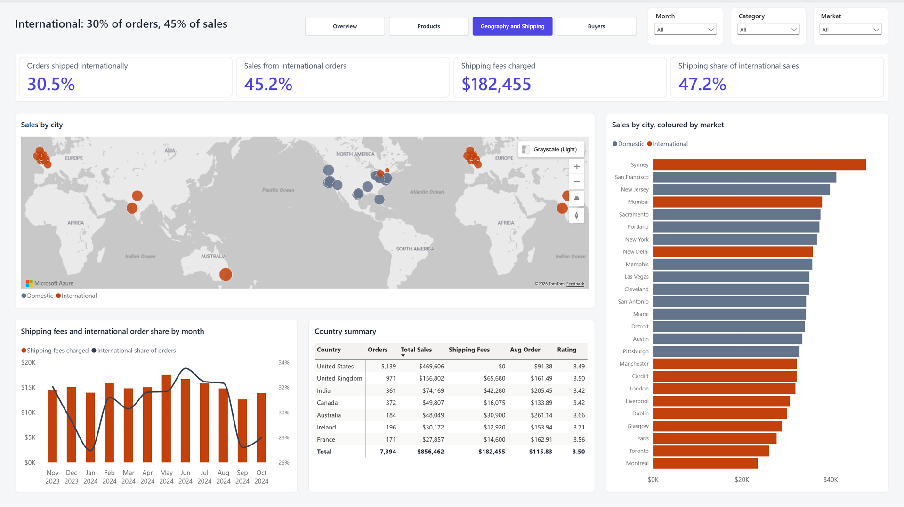
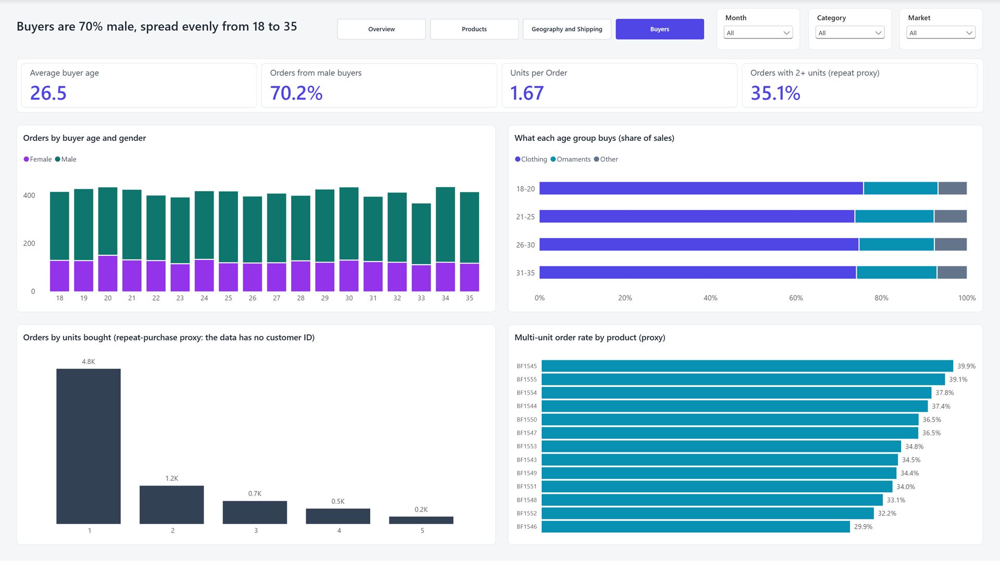

# Merchandise Sales Report

A four-page Power BI report on the first year of merchandise sales for Lee Chatmen, a TikTok creator who launched his own product line in 2023. It is built on the Onyx Data DataDNA dataset challenge (January 2025) and stored as a Power BI Project (PBIP), so the report and model are plain text files under version control.

The data covers 7,394 orders from 5 November 2023 to 4 November 2024: $856,462 in sales across 13 products, 3 categories and 25 cities.

## Pages

### Overview

Sales hold between about $62K and $81K a month, and Clothing brings in roughly three quarters of the total.

### Products

The five clothing products are the five best sellers. Average ratings sit between 3.4 and 3.6 for every product, so ratings do not explain sales.

### Geography and Shipping

International orders are 30.5% of orders but 45.2% of sales. Much of that gap is shipping: fees make up 47.2% of international sales.

### Buyers

About 70% of orders come from male buyers, spread evenly across ages 18 to 35. The category mix barely changes with age.

## Questions the report answers

| Question from the brief | Page |
|---|---|
| What are the overall sales trends? | Overview |
| Which product categories perform best? | Overview |
| What are the most and least popular products? | Products |
| How does location affect sales? | Overview, Geography and Shipping |
| What impact does international shipping have? | Geography and Shipping |
| What is the demographic profile of buyers? | Buyers |
| How do ratings and reviews correlate with sales? | Products |
| What are the trends in shipping charges? | Geography and Shipping |
| How do discounts influence purchasing? | Products (proxy) |
| Are there patterns in repeat purchases? | Buyers (proxy) |

## Limits of the data

- **No discount data.** Every product has one price all year. The report uses the share of reviews that praise price or discounts (11.6%) as a proxy.
- **No customer ID.** Repeat purchases cannot be measured. The report uses orders with two or more units (35.1%) as a proxy.
- **Sales include shipping.** `Total Sales = (Sales Price + Shipping Charges) x Quantity`, so shipping is charged per unit.
- **Shipping fees are fixed per destination** (US $0, Canada $25, UK and Ireland $40, France $50, India $70, Australia $100). Monthly changes in shipping fees only reflect a change in where orders ship to.
- **November 2024 has 4 days of data** and is left out of the two monthly trend charts.
- **Page headlines are fixed text.** They describe the full dataset and do not change with the slicers.

## Model

One fact table (`Data`, one row per order) and a `Date` table.

- **Calculated columns:** Country, Market (Domestic / International), Age Group, Sentiment, Review Theme, Order Size
- **Measures:** Sales, Product Revenue, Shipping Revenue, Orders, Units Sold, Avg Order Value, Units per Order, Avg Rating, Positive Review %, Negative Review %, Price Praise %, International Orders %, International Sales %, Shipping % of International Sales, Avg Buyer Age, Male Buyer %, Multi-Unit Order %

## Opening the report

1. Install Power BI Desktop (a version that supports PBIP and the PBIR report format).
2. Clone this repository and open `Merchandise Sales Report.pbip`.
3. Fix the data source path before refreshing. The `Data` and `Dictionary` queries read the Excel workbook from an absolute path on the original author's machine. In Power Query, point both at the workbook in `WgsUBfjr5GWNOHRpFmBP6oKmUDm5T53pipHgRQhh/` inside your clone.
4. Refresh.

The map on the Geography and Shipping page uses the Azure Maps visual, which must be enabled in your Power BI Desktop or tenant settings.

## Repository layout

| Path | Contents |
|---|---|
| `Merchandise Sales Report.pbip` | Project entry point |
| `Merchandise Sales Report.Report/` | Report definition: pages, visuals, theme |
| `Merchandise Sales Report.SemanticModel/` | Model definition in TMDL |
| `WgsUBfjr5GWNOHRpFmBP6oKmUDm5T53pipHgRQhh/` | Source workbook and challenge brief from Onyx Data |
| `_brief/report-spec.md` | Report specification written before the build |
| `docs/screenshots/` | Page screenshots used in this README |

## Data source

Onyx Data, DataDNA Dataset Challenge, Merchandise Sales Dataset, January 2025. The dataset belongs to Onyx Data.
